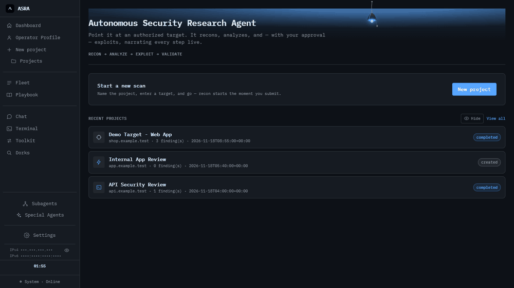
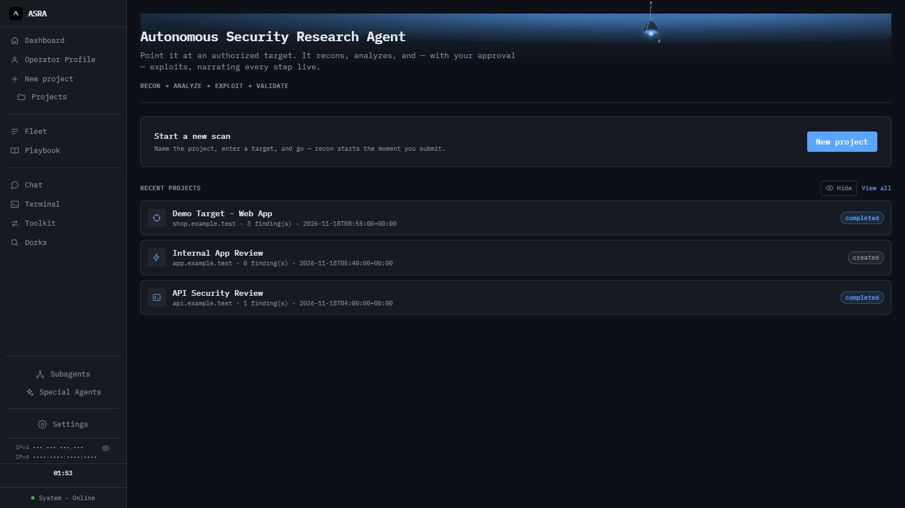
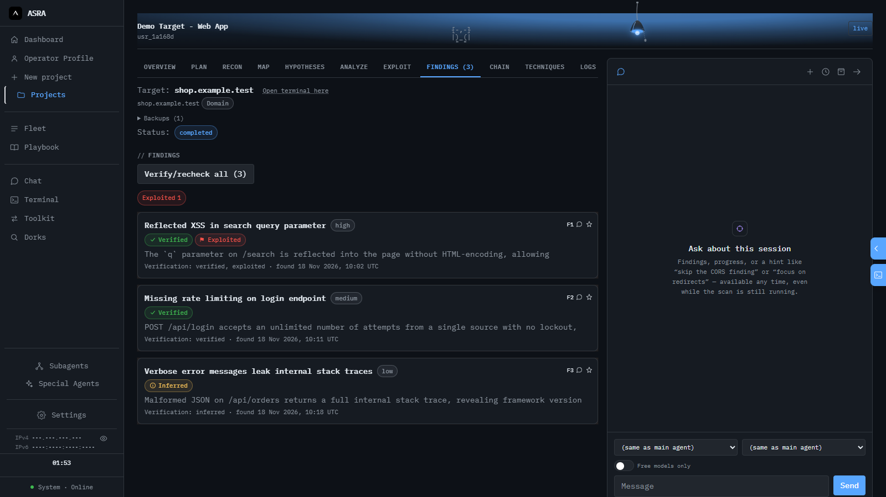

<h1 align="center">
  
</h1>

<p align="center">
  <a href="https://github.com/Atennebris/ASRA/releases/latest"></a>
  <a href="https://github.com/Atennebris/ASRA/actions/workflows/release.yml"></a>
  <a href="LICENSE"></a>
  <a href="docs/Documentation_en.md"></a>
  <a href="docs/Documentation_ru.md"></a>
  <a href="https://discord.gg/D998kaDm79"></a>
  <a href="https://hub.xerj.org/contributors/Atennebris"></a>
</p>

<p align="center">
  <a href="#quick-start">Quick start</a> ·
  <a href="#screenshots">Screenshots</a> ·
  <a href="docs/Documentation_en.md#architecture">How it works</a> ·
  <a href="docs/Documentation_en.md#stage-2-install-and-run-asra">Install</a> ·
  <a href="docs/Documentation_en.md#configuration">Configuration</a> ·
  <a href="SECURITY.md">Security</a>
</p>

Point ASRA at a target you are authorized to test. It recons, analyzes and, only on targets you
explicitly authorize, exploits. An LLM drives it through a ReAct tool-calling loop and every step
streams live in the browser. Everything runs locally: no cloud, no database, session state is
plain JSON on disk.

<p align="center">
  
</p>

The full documentation covers features, architecture, per-OS setup, the configuration reference,
development and uninstalling. It comes in [English](docs/Documentation_en.md) and
[Русский](docs/Documentation_ru.md).

## Screenshots

Demo data only (reserved `example.test` targets), no real engagement is shown.

<p align="center">
  
  
</p>

## Quick start

| OS | Runs via | Start command |
|---|---|---|
| Windows | WSL2 (no native Windows run path) | double-click `run.bat` |
| Linux | native | `bash run.sh` |
| macOS | native (Homebrew for tool installs) | `bash run.sh` |

```bash
git clone <this-repo-url>
cd ASRA
cp .env.example .env     # add an LLM_PROVIDER API key, or leave as-is for opencode-zen (free, no key)
bash setup_tools.sh      # Linux/WSL2: installs nmap/nuclei/metasploit/sqlmap/...; macOS uses Homebrew, see docs
bash run.sh              # Windows: run.bat instead
```

Open `http://localhost:8000`. Windows needs WSL2 set up first; see
[docs/Documentation_en.md](docs/Documentation_en.md#stage-1-prepare-your-machine-wsl2-and-security-tools)
for that and the optional desktop app.

## Test scope / Legal notice

This agent performs active scanning, vulnerability probing, and, for the allowed target only,
real exploitation. All built-in test targets are public applications that explicitly authorize
security testing:

| Target | Authorization |
|---|---|
| `juice-shop.herokuapp.com` | OWASP Juice Shop, intentionally vulnerable app |
| `ginandjuice.shop` | Official PortSwigger test target |
| `google-gruyere.appspot.com` | Google, explicitly authorized attack target |
| `public-firing-range.appspot.com` | Google, official automated-scanner test bed |

Real exploitation only ever runs against a target explicitly authorized via the New Project
dialog's "Authorize exploitation" checkbox, enforced as a hard guardrail in the tool runner, not
by convention. No other domain is in scope. Full rules:
[docs/Documentation_en.md#test-scope--legal-notice](docs/Documentation_en.md#test-scope--legal-notice).

## Disclaimer

ASRA is for authorized security testing only, provided "as is" with no warranty, see
[LICENSE](LICENSE). You are solely responsible for obtaining proper authorization before pointing
ASRA at any target, and for complying with applicable laws. See
[SECURITY.md](SECURITY.md) and the full
[Disclaimer](docs/Documentation_en.md#disclaimer) for details.

ASRA's own code is independently designed and implemented; it orchestrates well-known third-party
security tools (Nmap, Nuclei, sqlmap, Metasploit, etc.) as separate licensed processes, none of
their code is bundled or copied here. See
[Intellectual property & third-party software](docs/Documentation_en.md#intellectual-property--third-party-software)
for the full policy, including on reverse-engineering/clean-room methodology.

## License

MIT, see [LICENSE](LICENSE).
