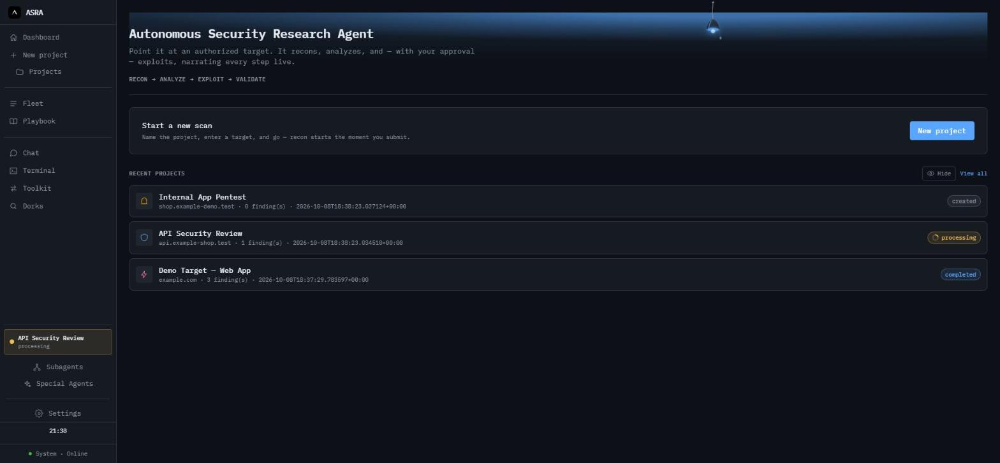
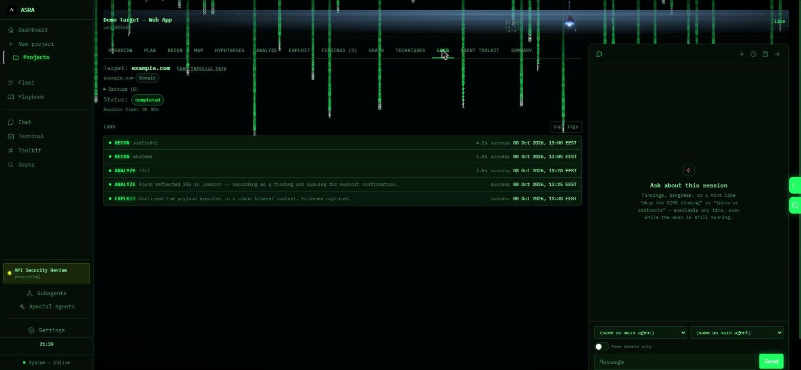
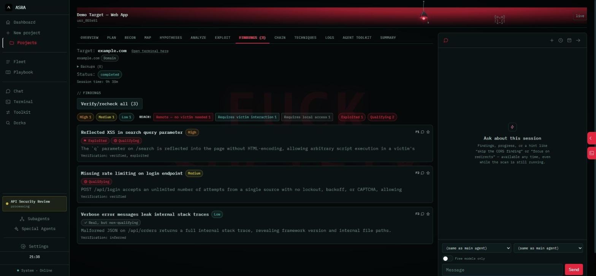
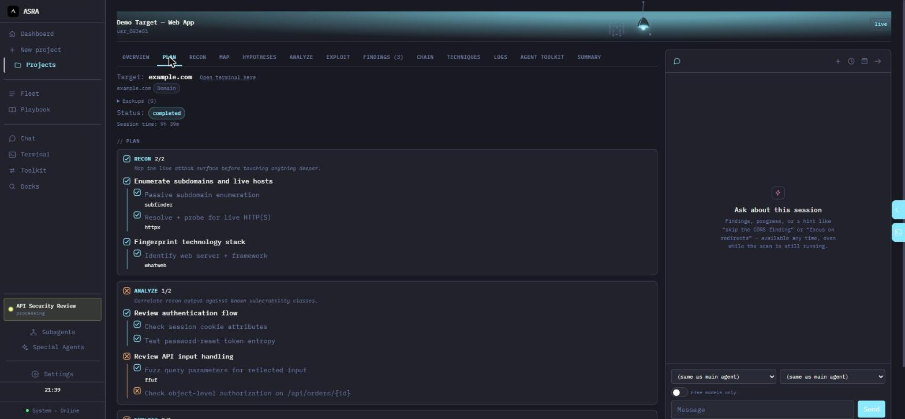
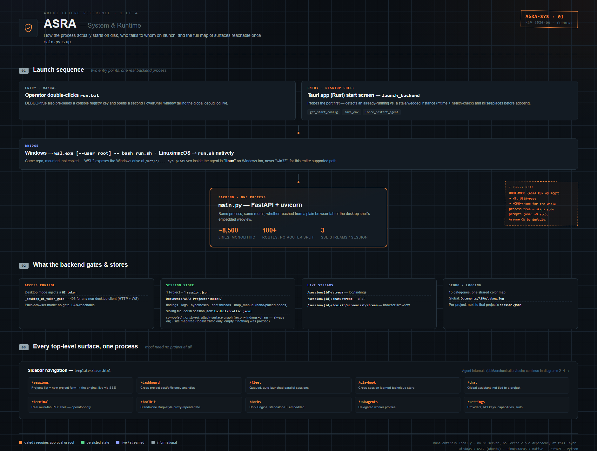
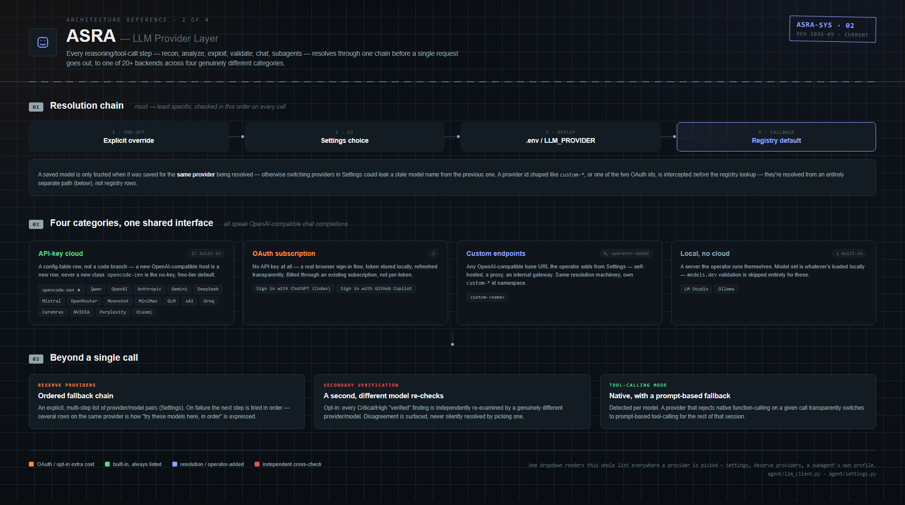
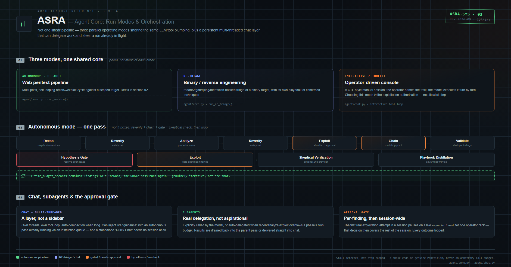
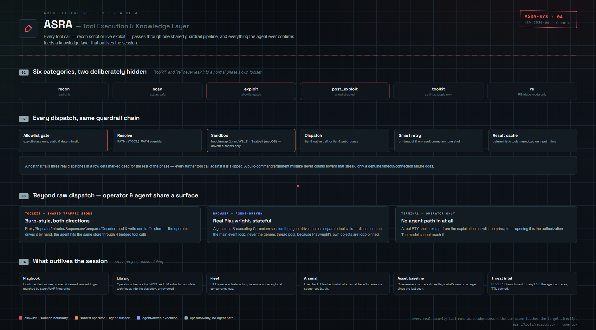

# ASRA — полная документация

Это полный справочник по ASRA: возможности, архитектура, установка на всех ОС, конфигурация,
скриншоты, разработка и удаление. Корневой [README.md](../README.md) репозитория сознательно
короткий — краткое описание и минимум для запуска; всё остальное здесь.

English version: [docs/Documentation_en.md](Documentation_en.md). Дополнительные языки, если будут
добавлены позже, следуют тому же соглашению об именах в этой папке: `Documentation_<lang>.md`
(этот файл — `Documentation_ru.md`, русский).

## Содержание

- [Для кого ASRA](#для-кого-asra)
- [Проблема](#проблема)
- [Возможности](#возможности)
- [Скриншоты](#скриншоты)
- [Архитектура](#архитектура)
- [Как это работает на вашей ОС](#как-это-работает-на-вашей-ос)
- [Этап 1: подготовка машины (WSL2 и инструменты безопасности)](#этап-1-подготовка-машины-wsl2-и-инструменты-безопасности)
- [Этап 2: установка и запуск ASRA](#этап-2-установка-и-запуск-asra)
- [Использование](#использование)
- [Конфигурация](#конфигурация)
- [Разработка](#разработка)
- [Удаление / полное избавление от всего](#удаление--полное-избавление-от-всего)
- [Разрешённые цели / Юридическое примечание](#разрешённые-цели--юридическое-примечание)
- [Отказ от ответственности](#отказ-от-ответственности)
- [Интеллектуальная собственность и стороннее ПО](#интеллектуальная-собственность-и-стороннее-по)

## Для кого ASRA

ASRA рассчитан на весь спектр *авторизованной* наступательной безопасности: охотников за
багбаунти, автоматизирующих рутину recon → analyze → exploit в рамках программ, на которые уже
получен доступ; OSINT-исследователей, которым нужно картировать поверхность атаки без ручного
связывания десятка инструментов; пентестеров и red-team специалистов, которым нужна эксплуатация с
allowlist-гейтингом и полным аудит-логом, с опциональным подтверждением оператора на каждую попытку
(`EXPLOIT_REQUIRE_APPROVAL=true`); исследователей безопасности и CTF-игроков, изучающих, как
автоматическая цепочка эксплуатации рассуждает по каждой находке, на лабах или встроенных
одобренных демо-целях; студентов и энтузиастов, осваивающих логику связывания инструментов,
наблюдая за рассуждениями ReAct-цикла в реальном времени; и всех, кто оценивает LLM-driven
инструментарий безопасности как рабочий, доступный в исходниках пример.

Ничто из этого не заменяет авторизацию — каждый из перечисленных сценариев предполагает, что на
тестирование конкретной цели уже есть явное разрешение. См. [Отказ от ответственности](#отказ-от-ответственности)
и [Разрешённые цели / Юридическое примечание](#разрешённые-цели--юридическое-примечание).

## Проблема

Авторизованное тестирование безопасности — медленный и требующий экспертизы процесс: человек
вручную запускает и интерпретирует десяток разных инструментов (Nmap, Nuclei, sqlmap, Metasploit,
...), вручную связывая recon → анализ → эксплуатацию и решая следующий шаг по сырому выводу каждого
инструмента. Именно эта ручная связка — а не сами инструменты — и есть узкое место для небольших
команд и одиночных исследователей, которым нужны частые, быстрые, авторизованные проверки, но нет
возможности тратить по целому дню на каждую цель.

ASRA автоматизирует эту цепочку целиком: LLM играет роль аналитика, читает реальный вывод
инструментов и решает, что запустить дальше, через ReAct-цикл (Recon → Analyze → Exploit →
Validate), вместо того чтобы человек делал это шаг за шагом. Каждая реальная попытка эксплуатации
проходит через явный allowlist — эта проверка применяется всегда — и по умолчанию выполняется
полностью автономно (каждое решение всё равно фиксируется в аудит-трейле, на который опирается
экспорт Proof-отчёта). Установите `EXPLOIT_REQUIRE_APPROVAL=true`, если хотите оставаться
единственным, кто принимает решение о любом деструктивном действии против цели — тогда каждая
попытка эксплуатации будет ставиться на паузу и ждать клика подтверждения в UI.

## Возможности

- **ReAct-конвейер, а не жёсткий скрипт** — Recon → Analyze → Exploit → Validate составляют
  костяк, но реальный прогон также перепроверяет собственные находки, строит многошаговые
  pivot-цепочки и возвращается на новый проход, пока остаётся временной бюджет — LLM вызывает
  реальные инструменты и реагирует на их настоящий вывод на каждом шаге. Полная схема — в разделе
  [Архитектура](#архитектура).
- **Живой веб-интерфейс** — весь прогон стримится в браузер через Server-Sent Events; без
  обновления страницы, без опроса.
- **Эксплуатация с allowlist-гейтингом, автономная по умолчанию** — реальная эксплуатация
  (Metasploit, sqlmap, проверки дефолтных учётных данных) запускается только против явно
  авторизованной цели; по умолчанию срабатывает немедленно (автоподтверждение, при этом полностью
  логируется); установите `EXPLOIT_REQUIRE_APPROVAL=true` для клика подтверждения оператором перед
  каждой попыткой в рамках сессии.
- **Чат с оператором** — направляйте работающий скан, не перезапуская его: добавляйте указания,
  пропускайте находку или сразу переходите к глубокому разбору конкретной.
- **Возобновляемые сессии** — падение или перезапуск посреди скана не теряет прогресс; находки и
  логи сохраняются сразу по мере появления, а прерванная сессия возобновляется с того места, где
  остановилась.
- **Подключаемые LLM-провайдеры** — opencode-zen (по умолчанию, бесплатно, без ключа), Qwen,
  Mistral и OpenRouter работают из коробки, плюс локальные провайдеры (LM Studio, Ollama,
  собственный CLI opencode как локальный сервер) для полностью офлайн-работы. Добавление ещё
  одного OpenAI-совместимого провайдера — одна строка конфигурации, без изменения кода.
  Переключатель "Free models only" в настройках фильтрует все селекторы моделей, оставляя только
  те, что провайдер сам заявляет бесплатными.
- **Расширяемый реестр инструментов** — встроенные инструменты (Nmap, Nuclei, Metasploit, sqlmap,
  Nikto, WhatWeb, Wpscan, Dalfox, ffuf, Subfinder, Arjun, Hydra) плюс всё, что уже есть на `PATH`
  (amass, gobuster, ...), плюс собственные скрипты через `custom_tools.yaml`. Arjun — единственное
  исключение из "ставится через `setup_tools.sh`" — это чистый Python-инструмент, устанавливаемый
  как любая другая зависимость через `requirements.txt`/`run.sh`, без отдельного шага в WSL.
- **Реальный брутфорс учётных данных без блокировки агента** — Hydra (SSH/FTP/telnet/
  MySQL/PostgreSQL/RDP/SMB) и собственный CSRF-aware брутфорсер веб-форм логина работают как
  настоящие фоновые задачи: `hydra_start`/`web_login_bruteforce_start` сразу возвращают ID задачи,
  и агент продолжает работать над другими находками, пока `background_job_check` опрашивает
  результат. Сначала выполняется реальная эмпирическая преflight-проверка (несколько заведомо
  неверных логинов на предмет реального сигнала блокировки/CAPTCHA/rate-limit) — незащищённая цель
  получает настоящую попытку, защищённая — чистый пропуск вместо слепого угадывания. Тот же
  allowlist и тот же gate подтверждения, что и у любого другого инструмента эксплуатации.
- **Каталог словарей** — раздел "Wordlists" в настройках автоматически обнаруживает все словари,
  уже лежащие на диске в местах, которыми управляет `setup_tools.sh` (подборки SecLists,
  rockyou.txt, дефолтный словарь ffuf, встроенные списки Metasploit), с реальным количеством строк
  и размерами. Поле "Download wordlist" скачивает любой URL прямо в локальную запись каталога
  (потоково, с жёстким лимитом размера — действие только для человека, агент никогда не может его
  вызвать). Каждый инструмент, принимающий словарь (ffuf, Arjun, логины/пароли Hydra,
  логины/пароли web_login_bruteforce), можно привязать к конкретной записи каталога; явно
  указанный моделью словарь всё равно имеет приоритет над привязкой, а устаревшая привязка
  (файл переместили/удалили вне приложения) аккуратно откатывается на дефолтный словарь
  инструмента, а не ломает прогон.
- **Субагенты** — именованные, заранее настроенные профили-воркеры (свой чек-лист разрешённых
  инструментов, свои инструкции/личность, опционально свой LLM-провайдер/модель), управляются во
  вкладке **Subagents**. Пока скан выполняется, основной агент может передать ограниченную,
  самодостаточную подзадачу включённому субагенту через `delegate_to_subagent` и сразу продолжить
  заниматься чем-то более важным сам — он блокируется только непосредственно перед завершением
  фазы, если этот субагент ещё не закончил. Субагент работает как по-настоящему параллельный фоновый
  LLM-диалог и сам отправляет результат обратно по завершении; `check_subagent_task` — запасной
  вариант на редкий случай, если эта отправка не дошла. Вкладка **Tools** показывает каждый
  зарегистрированный инструмент и то, установлен ли он реально на этой машине прямо сейчас — та же
  живая проверка питает чек-лист инструментов во вкладке Subagents, так что профилю можно выдать
  только те инструменты, которые реально существуют.
- **Экспорт Proof-отчёта** — один клик превращает завершённую сессию в самостоятельный HTML-отчёт:
  находки, реальные доказательства и полный аудит-трейл подтверждений оператором.
- **Только локально** — никакой зависимости от облака, кроме самого вызова LLM API, и никакой базы
  данных; состояние сессии — обычный JSON на диске.

## Скриншоты

ASRA поставляется с 30+ встроенными темами интерфейса (Settings → Customization). Ниже —
иллюстративные скриншоты синтетического демо-проекта (без реальной цели, провайдера или находки):

**Дашборд** — недавние проекты одним взглядом, у каждого свой статус:



**Лог запуска в реальном времени** (тема `neo`) — каждый вызов инструмента по мере появления, с
меткой фазы и временем:



**Находки** (тема `mr-robot`) — бейджи severity/эксплуатировано/подходит для баунти по каждой
находке:



**План** (тема `dracula`) — собственная живая разбивка агента по фазам → задачам → подзадачам:



## Архитектура

ASRA — не один линейный конвейер: браузерный/десктопный фронтенд общается с единым локальным
FastAPI-бэкендом, который разрешает каждый шаг рассуждения/вызова инструмента через подключаемый
слой LLM-провайдеров (20+ бэкендов по категориям API-ключ/OAuth/кастомные/локальные), выполняет
инструменты через единый общий guardrail-конвейер и сохраняет как состояние сессии, так и
накопленные межсессионные знания (playbook, библиотека, fleet) в виде обычного JSON на диске — без
базы данных. Четыре диаграммы покрывают это целиком:

**Система и среда исполнения** — как процесс реально запускается (десктопная оболочка / мост
WSL2), что бэкенд контролирует и хранит, и каждая верхнеуровневая поверхность, достижимая после
запуска:



**Слой LLM-провайдеров** — цепочка разрешения и четыре категории бэкендов, к которым она может
привести:



**Ядро агента — режимы работы и оркестрация** — три параллельных режима работы (автономный
конвейер, RE-триаж, интерактивный/toolkit), нелинейный автономный проход, и слой
чат/субагенты/gate подтверждения:



**Слой выполнения инструментов и знаний** — общий guardrail-конвейер, через который проходит
каждый вызов инструмента, и что накапливается между сессиями:



## Как это работает на вашей ОС

Сам ASRA — обычный Python (FastAPI). Причина, по которой нельзя "просто запустить нативно везде" —
инструменты безопасности, которые он использует: Nmap, Nuclei, Metasploit, sqlmap — это Linux-инструменты.

| Ваша ОС | Что реально запускает ASRA | Что делать |
|---|---|---|
| **Windows** | WSL2 (любой дистрибутив) — ASRA **не** запускается нативно на Windows | Дважды кликните **`run.bat`**. Он находит WSL2 и запускает `run.sh` внутри него — вам не нужно самому открывать терминал WSL. В первый раз на чистой машине сначала выполните [Этап 1](#этап-1-подготовка-машины-wsl2-и-инструменты-безопасности). |
| **Linux** | Нативно — WSL вообще не задействован | Запустите **`bash run.sh`** напрямую. |
| **macOS** | Нативно — ни WSL, ни Linux-VM | Запустите **`bash run.sh`** напрямую. Установка инструментов идёт через Homebrew вместо `apt` — этот путь написан аккуратно, но не проверялся на физическом Mac-железе, в отличие от пути Linux/WSL2. |

`run.sh` — реальный исполнитель во всех случаях: он создаёт локальный для проекта venv, ставит
Python-зависимости и запускает сервер. `run.bat` — лишь обёртка со стороны Windows, передающая
управление ему. После запуска сервера откройте `http://localhost:8000` в обычном браузере.

Путь от чистой машины до работающего ASRA — всегда два этапа, строго в этом порядке:

1. **[Этап 1](#этап-1-подготовка-машины-wsl2-и-инструменты-безопасности) — подготовка машины.**
   Только для Windows: установка WSL2. Затем, на любой ОС: установка самих инструментов
   безопасности (Nmap, Nuclei, Metasploit, sqlmap, Nikto), которые использует ASRA. Делается один
   раз на машину.
2. **[Этап 2](#этап-2-установка-и-запуск-asra) — установка и запуск самого ASRA.** Получить код,
   добавить API-ключ LLM, затем запустить единственный скрипт, который создаёт окружение Python,
   ставит собственные зависимости ASRA и запускает сервер.

## Этап 1: подготовка машины (WSL2 и инструменты безопасности)

Цель этого этапа — машина, на которой установлены и доступны на `PATH` **nmap, nuclei, msfconsole,
sqlmap, nikto, whatweb, wpscan, dalfox, ffuf, subfinder и hydra** — сам ASRA ничего из этого не
устанавливает и не поставляет в комплекте, он только их вызывает. Делается один раз на машину,
затем переходите к Этапу 2.

Этот же этап скачивает **Chromium для Playwright** — инструменты работы с headless-браузером
(`browser_navigate`/`browser_click`/... — `agent/tools/browser_manager.py`), которые позволяют
агенту видеть контент, отрендеренный JS (SPA, DOM-based XSS, клиентские флоу авторизации), а не
только сырой HTTP-ответ. Это pip-пакет (уже в `requirements.txt`) плюс отдельная загрузка браузера
~150МБ, которую подтягивает `setup_tools.sh`. Опционально — остальной ASRA работает и без этого
(эти инструменты сами сообщают, что не установлены, и агент переходит на
`http_request`/`view_source`), но рекомендуется, поскольку большинство реальных целей сегодня —
JS-рендеренные приложения.

**Всё на этом этапе опционально, не жёсткое требование для запуска ASRA.** Каждый внешний
инструмент сам сообщает `tool_unavailable`, если его нет на `PATH` — агент переходит на нативные
Python-инструменты, которые идут в комплекте с ASRA и не требуют ничего устанавливать
(`http_request`, `dns_lookup`, `whois`, `crt_sh_lookup`, `wayback_urls`, `common_crawl_urls`,
`shodan_internetdb_lookup`, `view_source` и другие). Можно запустить `bash run.sh` сразу после
чистого клонирования без единого инструмента с этого этапа и получить рабочего, пусть и более
слабого, recon-only агента — полезно, чтобы попробовать ASRA перед тем, как тратить место на
полный арсенал в ~6-8 ГБ, или на машине, которую хочется держать лёгкой. Ничего не падает намертво
из-за отсутствующего инструмента — просто будет меньше техник, и попроще, пока не выполните Этап 1
(или установщик прямо из приложения, см. ниже).

### Только для Windows: сначала настройте WSL2

Переходите сразу к [Установке инструментов безопасности](#установка-инструментов-безопасности-все-платформы),
если вы на Linux или macOS, либо WSL2 и дистрибутив уже установлены.

**Используете десктопный лаунчер?** Он сам определяет оба случая — WSL отсутствует вовсе, либо WSL
есть, но без единого зарегистрированного дистрибутива — и предлагает кнопку "Install WSL"/"Install
`<дистрибутив>`" прямо на стартовом экране (Windows всё равно покажет свой запрос разрешения; см.
шаги ниже, если не хотите его выдавать). Ручные шаги ниже всё равно применимы при использовании
`run.bat`/без десктопного приложения, либо как резервный вариант.

1. Откройте PowerShell **от имени администратора** и выполните:
   ```powershell
   wsl --install
   ```
   Это включает WSL2 и устанавливает Ubuntu (текущий LTS) как дистрибутив по умолчанию за один
   шаг. Перезагрузитесь, если попросит. Для другого дистрибутива/версии посмотрите доступные
   через `wsl --list --online` и установите через `wsl --install -d <имя>` — `run.bat` не важно,
   какой именно вы выберете (см. заметку про дистрибутив ниже).
2. При первом запуске он спросит имя пользователя/пароль Unix внутри WSL2 — это отдельно от входа
   в Windows, подойдёт что угодно.
3. Проверьте, что всё сработало:
   ```powershell
   wsl -- echo ok
   ```
   должно напечатать `ok`.
4. Переходите к [Установке инструментов безопасности](#установка-инструментов-безопасности-все-платформы)
   — всё отсюда выполняется **внутри** этого дистрибутива WSL2.

Если `run.bat` сообщает "WSL is not installed or not on PATH" — этот шаг ещё не выполнен.

**Какой дистрибутив/версия?** `run.bat` не хардкодит имя или версию дистрибутива — он использует
тот, который WSL считает *дистрибутивом по умолчанию* (`wsl --install` настраивает это
автоматически; проверить/сменить можно через `wsl --list` / `wsl --set-default <имя>`). Подойдёт
любой дистрибутив на базе Debian/Ubuntu, Fedora/RHEL или Arch, поскольку самому `run.bat` внутри
WSL2 нужны только `bash` и `wslpath` (они есть всегда). `setup_tools.sh` определяет и поддерживает
все три семейства пакетных менеджеров сам.

Если у вас установлено **больше одного** дистрибутива WSL и дефолтный — не тот, где настроен ASRA,
укажите `run.bat`, какой использовать:
```
set WSL_DISTRO=<имя-вашего-дистрибутива>
run.bat
```
(список установленных дистрибутивов — `wsl --list`).

**Запуск от root (опционально).** По умолчанию агент работает от обычного, не-root пользователя
вашего дистрибутива WSL2. Root нужен ровно для одной вещи: флагу `-O` (определение ОС) у nmap
нужны raw-сокеты, а для них нужен root. Без него `-O` просто пропускается, а остальной скан идёт
как обычно — это никогда не жёсткий сбой. Два способа получить работающий `-O`:

- **Сохранённый пароль sudo** (Settings → Optional interpreters/compilers) — касается не только
  nmap: любой вызов, которому реально нужен root (nmap `-O`, установщик Arsenal прямо в
  приложении, установка опциональных интерпретаторов) использует `sudo` с этим паролем, если он
  сохранён, иначе откатывается на passwordless `sudo` или понятное сообщение с командой для
  ручного запуска. Хранится в `.env` на этой машине открытым текстом — перед сохранением обратите
  внимание на предупреждение в настройках.
- **Запуск всего агента от root** — без sudo и пароля вообще, без какой-либо настройки (`root`
  существует на любом дистрибутиве Linux по определению, а `wsl.exe --user root` переключается на
  него напрямую без запроса пароля). Дважды кликните **`run-root.bat`** вместо `run.bat` — тот же
  скрипт, просто с уже заданным `WSL_USER=root`. (Эквивалент вручную: `set WSL_USER=root`, затем
  `run.bat`.)

### Установка инструментов безопасности (все платформы)

Windows (внутри WSL2), Linux и macOS — всем нужен этот шаг, разница только в том, *как* именно
ставить.

#### Linux / WSL2 — любой дистрибутив

```bash
bash setup_tools.sh
```

Один скрипт, безопасно перезапускать в любой момент (уже установленные инструменты определяются и
пропускаются). Он определяет ваш пакетный менеджер (`apt`/`dnf`/`pacman`) и ставит основные
инструменты, которые реестр агента ожидает на PATH: **nmap, nuclei, msfconsole (Metasploit),
sqlmap, nikto, whatweb, wpscan, dalfox, interactsh-client, ffuf, subfinder, hydra**, плюс
Python-зависимости venv/pip, нужные самому `run.sh`. У nuclei, interactsh-client, dalfox, ffuf и
subfinder нет пакета ни в одном дистрибутиве, поэтому они всегда берутся из последнего официального
релиза на GitHub независимо от дистрибутива; sqlmap/nikto/whatweb/wpscan откатываются на
клонирование/gem-установку напрямую из апстрим-проекта, если репозитории конкретного дистрибутива
их не содержат. hydra вместо этого откатывается на понятное сообщение о ручной установке (ей нужна
настоящая сборка `./configure && make` на C/C++, цепочка зависимостей которой слишком сильно
различается между дистрибутивами, чтобы безопасно автоматизировать). `setup_tools.sh` также ставит
небольшой дефолтный словарь для ffuf (`/usr/share/wordlists/ffuf/common.txt`) — переопределите
через `FFUF_WORDLIST_PATH` для большего/своего. Запустите его один раз при настройке машины, затем
в любой момент — чтобы подтвердить, что арсенал всё ещё цел (например, после `wsl --update` или
смены дистрибутива) — он печатает сводную таблицу, в точности совпадающую с тем, что увидит
собственная проверка здоровья реестра инструментов (`shutil.which`).

Только для перечисленных выше инструментов — см. `KNOWN_TOOLS` в `agent/tools/discovery.py`, как
реестр автоматически обнаруживает *дополнительные* recon/exploit-инструменты (например, `amass`,
`dnsx`, `httpx`, `gobuster`), если вы установите их отдельно; это опциональные расширения, не часть
этого скрипта.

Тот же скрипт также ставит собственный набор инструментов режима Reverse Engineering: **radare2**
(плюс плагин `r2ghidra` через `r2pm` для декомпиляции, и `radiff2`, идущий с ним в комплекте),
**gdb**, **strace** (поведенческий/syscall-триаж), **wine** (запускает Windows PE-цель напрямую для
динамического анализа), **heimdall** (декомпиляция EVM-байткода, через собственный установщик
`bifrost`, который сначала подтягивает тулчейн Rust/Cargo через `rustup`, если его нет), **upx**
(распаковка упакованных бинарников), **osv-scanner** и **trufflehog** (анализ зависимостей/секретов
в исходном репозитории), **apktool** и **jadx** (декомпиляция Android APK), **binwalk** (анализ
прошивок), **tshark** (захват пакетов — `dumpcap` получает `cap_net_raw`/`cap_net_admin` через
`setcap`, так что живой захват никогда не требует root), и **scanmem** (сканирование/патчинг памяти
живого процесса, инструменты `memscan_*` — тоже получает `cap_sys_ptrace` через `setcap`;
только Linux). `slither`, `semgrep`, `pyevmasm` (анализ Solidity / SAST / дизассемблирование EVM),
`frida` (динамическая инструментация), `pwntools` и `scapy` (скриптинг эксплойт-примитивов/пакетов
для `custom_re_script`) — обычные Python-пакеты, ставятся в venv автоматически через `run.sh`, как
и любая другая зависимость из `requirements.txt` — для этих шести ничего дополнительно запускать не
нужно.

#### macOS

```bash
brew install nmap sqlmap git python3 nikto whatweb wpscan hydra
brew install radare2 gdb   # режим Reverse Engineering — единственная часть setup_tools.sh, которая
                            # также работает на macOS (bash setup_tools.sh); всё остальное здесь —
                            # ручной список Homebrew. heimdall ставится так же, как на Linux
                            # (собственный установщик bifrost, запускаемый setup_tools.sh).
brew install nuclei ffuf subfinder dalfox   # все инструменты projectdiscovery/hahwul есть в Homebrew core
brew install --cask metasploit
```

Не проверено на физическом Mac-железе — это стандартные имена пакетов/касков Homebrew для каждого
инструмента, но если формула/каск переехали, проверьте `brew search <инструмент>` или сайт самого
инструмента. У interactsh-client нет формулы Homebrew — скачайте сборку `darwin` напрямую с
https://github.com/projectdiscovery/interactsh/releases и положите на PATH. `setup_tools.sh`
работает только на Linux/WSL2 (apt/dnf/pacman) — macOS вместо этого использует Homebrew. ffuf также
нуждается в словаре на macOS — автоустанавливаемый `setup_tools.sh` словарь доступен только на
Linux; возьмите, например, `Discovery/Web-Content/common.txt` из SecLists вручную и укажите
`FFUF_WORDLIST_PATH` на него.

Chromium/Playwright — единственное исключение, не требующее Homebrew вообще — `playwright install`
кроссплатформенный и сам справляется с macOS:
```bash
pip install "playwright==$(grep -oP '(?<=^playwright==)\S+' requirements.txt)"
playwright install chromium
```

**Контрольная точка Этапа 1** — прежде чем двигаться дальше, `nmap -V`, `nuclei -version`,
`msfconsole -v`, `sqlmap --version`, `nikto -Version`, `whatweb --version`, `wpscan --version`,
`dalfox version`, `ffuf -V`, `subfinder -version`, `hydra -h` и `interactsh-client -version` должны
печатать версию (а для hydra — баннер использования), а не "command not found". Собственная сводная
таблица `setup_tools.sh` (печатается в конце его работы) уже подтверждает это на Linux/WSL2,
включая Chromium/Playwright.

### Альтернатива: установка инструментов прямо из работающего приложения (только Linux/WSL2)

Вкладка **Tools** (когда сервер уже запущен, см. Этап 2 ниже) содержит собственные кнопки **Check
arsenal** / **Install**, которые выполняют ровно ту же живую проверку и тот же `setup_tools.sh`
прямо из браузера, с живым хвостом лога на странице по мере выполнения (несколько минут, ~6-8 ГБ
загрузки). Полезно для первой настройки через приложение вместо терминала, либо чтобы позже
подтвердить, что арсенал всё ещё цел, не покидая интерфейс.

- **Check arsenal** доступна всегда и ничего не запускает — та же проверка установки на основе
  `shutil.which`, которую сам агент выполняет перед каждым вызовом инструмента, с разбивкой по
  режимам (web-scan / reverse-engineering / HTTP toolkit).
  установленных тулов
- **Install** тем или иным способом требует root (как и запуск `setup_tools.sh` вручную): если
  процесс сервера уже root (`run-root.bat` / `WSL_USER=root`), он просто выполняется; иначе
  используется сохранённый пароль sudo (Settings → Optional interpreters/compilers), если он
  задан, затем откат на passwordless `sudo`, если он настроен на этой машине, а если ничего из
  этого не подходит — показывается точная команда `sudo bash setup_tools.sh` для вставки в
  настоящий терминал — он никогда не запрашивает пароль прямо на странице.
- **Только Linux/WSL2** — кнопка сама сообщает о неподдержке на нативном Windows или macOS.

## Этап 2: установка и запуск ASRA

### Получить код

```bash
git clone <this-repo-url>
cd ASRA
cp .env.example .env   # затем впишите в .env реальный API-ключ LLM_PROVIDER (opencode-zen работает и без ключа)
```

На Windows делайте это один раз внутри вашего дистрибутива WSL2 (терминал WSL, либо `wsl --` из
PowerShell) — `git clone` и редактирование `.env` должны происходить именно на стороне файловой
системы WSL2, поскольку именно там `run.sh`/`run.bat` будут их искать.

### Установить зависимости и запустить сервер

Зависимости живут в **локальном для проекта виртуальном окружении**, а не в системном Python —
`run.sh` (ниже) создаёт `./venv` и ставит в него `requirements.txt` автоматически, при первом и
при каждом последующем запуске (он хэширует `requirements.txt` и переустанавливает зависимости
только при изменении хэша, так что повторный запуск всегда дешёвый). Вручную то же самое:

```bash
python3 -m venv venv
source venv/bin/activate
pip install -r requirements.txt
```

**Windows:** дважды кликните `run.bat`, либо запустите его из обычного `cmd`/PowerShell:
```
run.bat
```
Он находит WSL2, транслирует путь проекта и запускает `run.sh` внутри вашего дефолтного
дистрибутива WSL2 (или конкретного, если задан `WSL_DISTRO` — см. заметку про дистрибутив в
Этапе 1). Для запуска от root см. "Запуск от root" выше (`WSL_USER=root`).

**Linux / macOS:**
```bash
bash run.sh
```
(Запускается именно как `bash run.sh`, а не `./run.sh`, намеренно — свежий `git clone` не
гарантированно сохраняет бит исполняемости на любой файловой системе, а `bash run.sh` работает в
любом случае без шага `chmod`.) Для запуска от root здесь просто запустите его от root напрямую
(`sudo bash run.sh`).

В любом случае это создаёт/обновляет `./venv`, ставит зависимости и запускает сервер на порту из
`.env` (`PORT`, по умолчанию `8000`). Откройте `http://localhost:8000` — на Windows WSL2
автоматически перенаправляет `localhost` на сторону Windows, без отдельной настройки
проброса портов.

Эквивалентный ручной запуск (когда venv уже настроен):
```bash
source venv/bin/activate
python main.py
```

Автономный CLI (без веб-интерфейса, сразу запускает одну сессию скана):
```bash
python -m agent.core --target <авторизованная-цель-из-таблицы-ниже>
```

### Опционально: десктопное приложение (нативное окно)

Помимо браузерного пути выше, у ASRA есть опциональная нативная десктопная оболочка — небольшое
окно со стартовым экраном, где перед запуском выбирается режим **Desktop** или **Web**. Она сама
запускает бэкенд, а затем либо показывает интерфейс прямо в окне (режим Desktop), либо выдаёт URL
для открытия в браузере (режим Web). Также добавляет системный трей (закрытие окна сворачивает в
трей, так что долгий скан продолжает работать; **Quit** из трея — чтобы реально остановить) и
нативное уведомление ОС по завершении сессии.

**Расширенные настройки запуска прямо на том же стартовом экране** — каждая переменная из `.env`
получает собственную строку (переключатель/поле пароля/текстовое поле, в зависимости от значения),
так что API-ключи провайдеров, порт, `EXPLOIT_REQUIRE_APPROVAL`, сохранённый пароль sudo и всё
остальное из `.env.example` можно настроить до запуска бэкенда, без шага с текстовым редактором.
Два параметра получают отдельные выделенные элементы управления: **Run the agent as root** (только
Windows/WSL2 — ничего не делает на нативной сборке этой оболочки под Linux/macOS, поскольку там
нет слоя WSL2, на который можно было бы нацелиться) и переключатель вступительной анимации при
запуске (вкл/выкл + звук). Если предыдущий запуск завис (завис сам WSL2, а не только бэкенд) —
стартовый экран также предлагает **Force restart ASRA**, который убивает застрявший
процесс/состояние дистрибутива и позволяет запуститься начисто.

Это опционально и дополнительно — `run.bat`/`run.sh` + браузер продолжают работать точно так же.
Оболочка живёт в `desktop/src-tauri/` (тонкая обёртка на Tauri/Rust — сама по себе она не рендерит
никакого интерфейса; весь интерфейс пентеста по-прежнему приходит от бэкенда Python/FastAPI).
Собрать и запустить:

```bash
cd desktop/src-tauri
cargo build --release            # нужен Rust (rustup) + инструменты сборки вашей ОС
./target/release/asra-desktop    # Windows: asra-desktop.exe
```

- **Windows:** собирает `asra-desktop.exe`; под капотом он запускает `run.sh` внутри WSL2, так же
  как `run.bat`.
- **Linux:** собирайте внутри WSL2 (или на нативном Linux) — та же команда, нужны системные
  зависимости Tauri (`libwebkit2gtk-4.1-dev`, `build-essential`, `libssl-dev`,
  `libayatana-appindicator3-dev`, `librsvg2-dev`). Он запускает `run.sh` напрямую.
- **macOS:** в коде нет ничего, что бы это специально блокировало (`spawn_backend` имеет настоящую
  не-Windows ветку, `tauri.conf.json` включает `.icns`), но никто ещё не собирал и не запускал эту
  оболочку на физическом Mac-железе — не проверено, но не "невозможно". Используйте браузерный путь
  (`bash run.sh` + `http://localhost:8000`) как подтверждённо рабочий вариант для Mac, если не
  готовы быть первым, кто попробует там `cargo build --release`.
- **Rust нужен только машине, которая собирает.** Пользователю, запускающему уже собранный бинарник,
  он не нужен — exe представляет собой самодостаточный лаунчер размером ~9 МБ.
- Кэш сборки Rust в `target/` занимает несколько ГБ; выполните `cargo clean` по завершении, чтобы
  освободить место.
- В режиме Desktop интерфейс привязан к окну оболочки через токен, генерируемый заново при каждом
  запуске, так что случайная вкладка браузера не может достучаться до этого бэкенда; обычный путь
  браузер/`run.bat` никогда не гейтится. Граничный случай: если оболочка обнаруживает уже
  запущенный бэкенд и подключается к нему вместо запуска нового — тот подключённый экземпляр
  сохраняет тот гейтинг (или его отсутствие), который уже имел — токен можно задать только серверу,
  который реально запустил именно этот запуск.

## Использование

Когда сервер работает и вы открыли `http://localhost:8000`:

1. **New Project** — дайте имя и укажите одну или несколько целей (URL/хосты/IP через запятую),
   выберите LLM-провайдера и решите, авторизовать ли эксплуатацию для этой области (по умолчанию
   отмечено — снимите галочку для только recon/обнаружения, без реальной эксплуатации вообще).
2. **Наблюдайте за работой** — страница сессии стримится в реальном времени: каждая цель, которую
   находит Recon, и каждая находка, которую фиксирует Analyze, появляется мгновенно, без
   обновления страницы.
3. **Эксплуатация по умолчанию выполняется автономно** — как только Exploit подтверждает находку,
   она срабатывает немедленно против всего, что есть в allowlist (каждое решение всё равно
   фиксируется в аудит-трейле). Установите `EXPLOIT_REQUIRE_APPROVAL=true`, чтобы прогон
   останавливался и ждал вашего клика в интерфейсе перед каждой попыткой (переходит в "skipped" по
   таймауту, если не ответить вовремя — см. `EXPLOIT_APPROVAL_TIMEOUT_SECONDS` ниже).
4. **Направляйте в реальном времени** — поле чата на странице сессии позволяет подтолкнуть агента,
   сказать пропустить конкретную находку или сразу перейти к глубокому разбору одной из них, не
   перезапуская ничего.
5. **Экспорт доказательств** — после завершения сессии "Export proof report" скачивает
   самостоятельный HTML-файл со всеми находками, реальными доказательствами и аудит-трейлом
   подтверждений человеком.
6. **Settings** (`/settings`) — смена дефолтного LLM-провайдера/модели (применяется к каждому
   новому скану и чату сессии) без правки `.env`, и выбор темы интерфейса.

Прерванная сессия (например, сервер перезапустился посреди скана) отображается в списке сессий
(`/sessions`) как *interrupted*, с кнопкой **Resume**, которая продолжает прогон с последней
завершённой фазы вместо начала заново.

## Конфигурация

Каждая настройка времени выполнения живёт в `.env` — полный список с пояснениями в `.env.example`.
То, что стоит знать сразу:

| Переменная | По умолчанию | Что делает |
|---|---|---|
| `LLM_PROVIDER` | `opencode-zen` | Какого провайдера использовать — `opencode-zen` (бесплатно, без ключа), `qwen`, `mistral`, `openrouter` (каждому нужен свой `*_API_KEY`), локальный сервер `lmstudio`/`ollama` (без ключа), либо `opencode-local` (запускает CLI `opencode` как локальный сервер — бесплатно, без ключа, нужен `opencode` на `PATH`; выбирается только в Settings, не через эту переменную) |
| `ENABLE_EXPLOIT` | `true` | `false` запускает только Recon + Analyze — вообще без фазы эксплуатации |
| `EXPLOIT_REQUIRE_APPROVAL` | `false` | `false` (по умолчанию): эксплуатация выполняется автономно в момент, когда Exploit хочет что-то запустить (всё равно полностью логируется). `true`: пауза и ожидание клика подтверждения перед каждой попыткой. Проверка allowlist/scope применяется в любом случае — это только гейтит запрос подтверждения человеком |
| `LLM_REQUEST_TIMEOUT_SECONDS` | `120` | Таймаут на вызов LLM API перед включением повторов с backoff |
| `TOOL_TIMEOUT_SECONDS` / `EXPLOIT_TIMEOUT_SECONDS` | `600` / `600` | Таймаут на вызов recon/scan-инструментов против инструментов эксплуатации |
| `EXPLOIT_APPROVAL_TIMEOUT_SECONDS` | `300` | Актуально только при `EXPLOIT_REQUIRE_APPROVAL=true` — сколько ожидающий эксплойт ждёт подтверждения, прежде чем будет пропущен |
| `HYDRA_TIMEOUT_SECONDS` | `900` | Сколько фоновая задача `hydra_start`/`web_login_bruteforce_start` может выполняться, прежде чем будет убита и помечена `timeout` |
| `HYDRA_MAX_CONCURRENT_JOBS` | `2` | Максимум одновременных фоновых задач брутфорса на сессию — следующий вызов `hydra_start`/`web_login_bruteforce_start` пропускается, а не встаёт в очередь, пока одна не завершится |
| `SUBAGENT_TASK_TIMEOUT_SECONDS` | `900` | Сколько задача `delegate_to_subagent` может выполняться, прежде чем будет отменена и помечена `timeout` |
| `SUBAGENT_MAX_CONCURRENT_TASKS` | `2` | Максимум одновременных делегированных задач субагентов на сессию — следующий вызов пропускается, пока одна не завершится |
| `PROJECTS_DIR` | автоопределение | Куда сохраняются артефакты скана; по умолчанию `Documents/ASRA Projects` для вашей ОС, если не задано |
| `APP_DATA_DIR` | автоопределение | Куда пишется глобальный debug-лог; по умолчанию `Documents/ASRA` для вашей ОС, если не задано |
| `DEBUG` | `false` | Подробное логирование по категориям — см. Разработку ниже |
| `INTERACTSH_CLIENT_PATH` | автоопределение | Переопределить, если `interactsh-client` не на PATH (подтверждение слепых SSRF/XSS) |

LLM-провайдер/модель также можно позже сменить в `/settings` без повторной правки `.env`.

**Что ещё лежит на диске и где** — помимо `.env`, ASRA хранит API-ключи/OAuth-токены, allowlist
эксплуатации, учётные данные конкретных проектов и реальные данные сканов в `Documents/ASRA` /
`Documents/ASRA Projects` (см. `PROJECTS_DIR`/`APP_DATA_DIR` выше) — полная, точная опись в
[SECURITY.md](../SECURITY.md#data-asra-stores-locally-know-whats-on-disk), стоит прочитать перед
тем, как делиться debug-логом или машиной.

## Разработка

Набор тестов (изнутри venv):
```bash
pytest
```

Линтер:
```bash
ruff check .
```

Отладочное логирование — установите `DEBUG=true` в `.env` (или передайте `--debug` автономному
CLI) для подробного, по категориям, цветного логирования: активность сервера/UI/агента, не
привязанная к конкретному проекту, идёт в глобальный лог `Documents/ASRA/debug.log`; всё, что
привязано к конкретной сессии скана, также получает собственную копию в папке этого проекта, рядом
с `session.json`. На Windows `run.bat` также открывает второе отдельное окно консоли при
`DEBUG=true`, которое в реальном времени хвостит глобальный лог рядом с окном самого сервера.
Полезно, когда вызов инструмента, ответ LLM или действие в интерфейсе ведут себя не так, как
ожидалось.

## Удаление / полное избавление от всего

ASRA хранит собственное состояние ровно в двух местах вне git-чекаута, плюс то, что сами
инструменты безопасности установили на уровне системы:

- **Один проект** — кнопка **Delete** на странице проекта (или на `/sessions`) удаляет всю папку
  этого проекта (находки, логи, чаты, трафик toolkit, резервные копии) плюс файл его сохранённых
  учётных данных, если он есть. `/api/sessions/delete-all` делает то же самое сразу для всех
  проектов.
- **Все проекты вручную** — каждая папка проекта живёт в `Documents/ASRA Projects/` (или вашем
  переопределении `PROJECTS_DIR`) — удаление этой папки эквивалентно удалению каждого проекта через
  интерфейс.
- **Собственное состояние ASRA на уровне приложения** (выбор в Settings, allowlist эксплуатации,
  сохранённые API-ключи/OAuth-токены, playbook, записи каталога словарей, лог установки арсенала)
  живёт в `Documents/ASRA/` (или вашем переопределении `APP_DATA_DIR`) — отдельно от ваших проектов
  намеренно, так что удаление этого сбрасывает ASRA до чистой установки, не трогая данные проектов,
  и наоборот.
- **Сам код ASRA** — просто удалите папку, в которую вы сделали `git clone`. `./venv`
  (Python-зависимости) живёт внутри неё, так что для этого не нужен отдельный шаг удаления.
- **Кэш сборки десктопного приложения** (`desktop/src-tauri/target/`, несколько ГБ, если собиралось)
  — `cargo clean` изнутри `desktop/src-tauri`. Уже собранный бинарник `asra-desktop`/
  `asra-desktop.exe` — это просто файл; удаляйте как любой другой.
- **Инструменты безопасности, установленные `setup_tools.sh`/Homebrew на уровне системы** — сейчас
  нет автоматического деинсталлятора для этого (безопасное удаление живого набора инструментов
  безопасности, не затронув что-то несвязанное, что случайно делит с ним зависимость — то, что этот
  проект не автоматизировал). Чтобы удалить их самостоятельно: большинство были установлены через
  пакетный менеджер вашего дистрибутива (`sudo apt remove nmap nikto whatweb hydra ...` / `dnf
  remove` / `pacman -R`, либо `brew uninstall` на macOS) или каски Homebrew (`brew uninstall --cask
  metasploit`); остальные (nuclei, interactsh-client, dalfox, ffuf, subfinder, jadx, apktool, upx,
  osv-scanner, trufflehog, heimdall) были выложены как отдельные бинарники — собственный список
  измерения размера в `agent/tools/arsenal_install.py` называет реальные места установки для
  проверки: `/opt/metasploit-framework`, `/usr/share/metasploit-framework`, `/usr/local`,
  `/usr/lib/.../wine`, `/opt/jadx`, `/usr/share/wordlists`, `/usr/share/seclists`, `/usr/lib/jvm`,
  `/usr/lib/radare2` / `/usr/share/radare2`, `~/.cache/ms-playwright` (Chromium), `~/.dotnet`,
  `~/.foundry` — где `~` это `/root`, если всё запускалось от root, иначе домашняя папка вашего
  обычного пользователя WSL2/Linux.
- **Windows/WSL2, вариант "подчистить всё разом"** — поскольку каждый инструмент выше живёт только
  *внутри* вашего дистрибутива WSL2, никогда на стороне Windows, разрегистрация всего дистрибутива
  удаляет весь набор инструментов ASRA (и сам чекаут ASRA тоже, если он клонирован на файловой
  системе WSL2, а не `/mnt/c/...`) за один шаг: `wsl --unregister <имя-дистрибутива>` из PowerShell
  (см. `wsl --list` для имени). Это не трогает `Documents/ASRA`/`Documents/ASRA Projects` на
  стороне Windows — для них нужны отдельные ручные удаления выше.

## Разрешённые цели / Юридическое примечание

Этот агент выполняет активное сканирование (Nmap, Nuclei), проверку уязвимостей и — только для
разрешённой цели — реальную эксплуатацию (Metasploit, sqlmap). Чтобы каждый прогон оставался
легальным без развёртывания приватного лаба, все тестовые цели — публичные приложения, явно
разрешающие тестирование безопасности:

| Цель | Роль | Авторизация |
|---|---|---|
| `juice-shop.herokuapp.com` | Рекомендована для allowlist эксплуатации | OWASP Juice Shop — намеренно уязвимое приложение (SQLi/XSS/broken auth/IDOR и т.д.) |
| `ginandjuice.shop` | Разнообразие для демо recon/analyze | Официальная тестовая цель PortSwigger |
| `google-gruyere.appspot.com` | Разнообразие для демо recon/analyze | Google — явно авторизованная цель для атаки |
| `public-firing-range.appspot.com` | Recon/Analyze, фокус на XSS | Google — официальный тестовый полигон для автоматических сканеров |

Правила, применимые ко всему перечисленному выше:

- Инструменты категорий recon/scan (Nmap, Nuclei, нативные recon-инструменты) могут запускаться
  против любой цели, отправленной через форму скана, включая все четыре выше.
- Реальная эксплуатация (Metasploit, sqlmap, `default_creds_check`) запускается только против
  цели, которую вы явно авторизовали — галочка "Authorize exploitation" в диалоге New Project
  (по умолчанию отмечена; снимите для только recon/обнаружения). Этот allowlist хранится в
  `data/allowed_targets.json` и пуст, пока какой-либо проект реально не авторизует что-то — никогда
  не заполняется из `.env` или самой LLM; применяется как жёсткий guardrail в исполнителе
  инструментов (`agent/tools/runner.py`), а не просто по соглашению. Эта проверка применяется
  всегда, независимо от `EXPLOIT_REQUIRE_APPROVAL` — установите его в `true`, если хотите, чтобы
  каждая отдельная попытка эксплуатации также ставилась на паузу для отдельного подтверждения
  человеком в интерфейсе сессии (по умолчанию — автономно, но всегда логируется).
- Это общие публичные цели, которыми пользуются многие другие люди для той же цели — агент не
  должен заваливать их ненужными агрессивными шаблонами Nuclei или фаззингом; только то, что
  реально нужно конкретному демо-сценарию.
- Никакой другой домен не входит в область действия. Агент не авторизован сканировать или
  эксплуатировать что-либо за пределами этой таблицы.

## Отказ от ответственности

ASRA — инструмент для авторизованного тестирования безопасности. Он предоставляется "как есть", без
каких-либо гарантий — полный текст в [LICENSE](../LICENSE). Автор не несёт ответственности за то,
как другие пользователи решают использовать это ПО, включая любое неавторизованное, незаконное или
неэтичное использование против систем, которыми они не владеют или на тестирование которых у них
нет явного письменного разрешения. Запуск активных сканов или эксплуатации против цели, на
тестирование которой у вас нет авторизации, может нарушать закон (например, CFAA в США, Computer
Misuse Act в Великобритании или аналогичное законодательство в других юрисдикциях) и собственные
условия использования цели. Вы несёте единоличную ответственность за получение надлежащей
авторизации перед тем, как направить ASRA на любую цель, и за соблюдение всех применимых законов и
соглашений — см. [Разрешённые цели / Юридическое примечание](#разрешённые-цели--юридическое-примечание)
выше и [SECURITY.md](../SECURITY.md).

## Интеллектуальная собственность и стороннее ПО

Собственный код ASRA — агент, оркестрация, прикладная логика — спроектирован и реализован автором
независимо. В этот репозиторий не скопировано никакого проприетарного исходного кода, коммерческих
тайн или защищённых авторским правом материалов, принадлежащих третьим лицам.

ASRA оркестрирует известные, независимо лицензированные инструменты безопасности (например, Nmap,
Nuclei, sqlmap, Metasploit) как отдельные внешние процессы. Их код не встроен, не упакован и не
распространяется в составе этого репозитория — каждый инструмент остаётся собственностью своих
авторов, под своей лицензией, используется так, как это предусмотрено этой лицензией.

Если какой-либо компонент ASRA изучает наблюдаемое поведение стороннего ПО с целью обеспечения
совместимости (например, чтобы понять формат вывода, протокол или поверхность API), это делается в
рамках применимых исключений для реверс-инжиниринга/совместимости (таких как 17 U.S.C. § 1201(f) в
США или статья 6 Директивы ЕС 2009/24/EC). Там, где для конкретного компонента явно заявлена
методология "чистой комнаты" (clean-room), это означает документированное разделение между
процессом, создавшим поведенческую спецификацию, и процессом, который реализовал её исключительно
по этой спецификации, без доступа к исходному коду оригинала. Такое заявление делается только для
тех компонентов, для которых эта процедура была реально выполнена.

ASRA не заявляет об аффилированности, одобрении или спонсорстве со стороны какого-либо стороннего
инструмента, вендора или правообладателя товарного знака, упомянутого в этом проекте. Все товарные
знаки являются собственностью их соответствующих владельцев.
